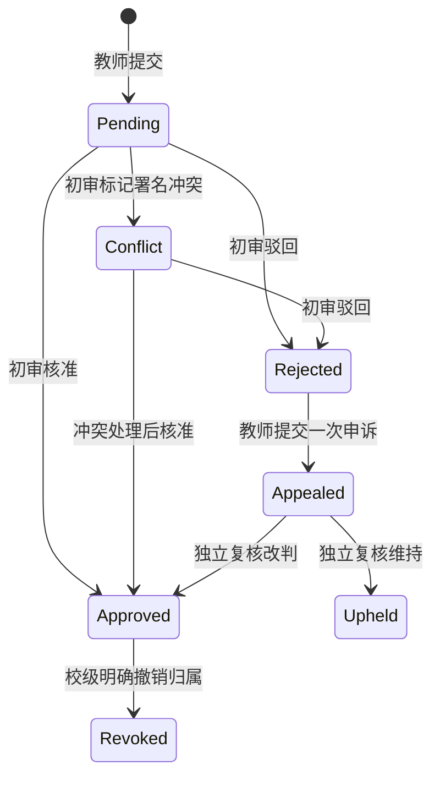
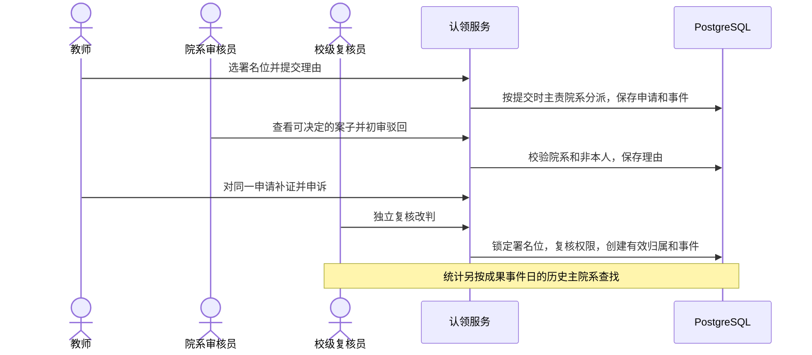

# 认领工作流状态与交互

## UML 状态图 · 一人一个署名位一份申请

转派改变初审的管辖，不改变统计院系，也不是审批决定。忽略推荐不创建申请或审计事件，不阻挡自行按标识认领。不同教师可认领一项成果的不同署名位；要核准某署名位上的竞争申请，须先明确纠正旧归属，不能覆盖。

## UML 时序 · 乙院初审、校级复核、甲院统计

## 工作台投影

| 入口 | 规则 |
|---|---|
| 我的申请 `stage=all` | 查询本人全部案件，含已完成与历史记录。 |
| `stage=in_progress` | 待初审、冲突待处理、申诉待复核。 |
| `stage=appeal_available` | 初审已驳回，允许打开同一申请申诉一次。 |
| `stage=finished` | 已核准、维持驳回或已撤销；校级纠错权仍适用。 |
| 审核台 `review=actionable`（默认） | 只显示有权做**初审或复核决定**的未处理案件，按提交从早到晚。本院初审、校级补位未分派初审、校级独立复核分别判断。仅可转派的案件不在此列。 |
| `review=all` | 显示授权范围内的案件，含历史和仅可转派案件，按最近提交优先。切换列表不扩大详情读取或写入授权。 |

申请人与其他竞争申请隔离，即使账号同时具有教师和审核职责。列表、详情、表单动作都服务端查权；列表是当前投影，不能保证打开时状态仍相同，提交动作必须重新校验状态和锁。分页范围独立；切换一个筛选时重置该列表页码，保留另一列表状态和 DOI 搜索。

覆盖 [工作流测试](../../tests/test_claims_workflow.py) 和 [独立待办验收](../../tests/test_acceptance_queue.py)。

审核工作台按提交时刻计算已等待至少 7 天的待初审案件，仅计入当前账号能做初审决定的申请。此提醒没有外发通知和自动状态变更。申请详情支持按事件类型筛选，教师仍只可见本人进度中获授权的事件。
