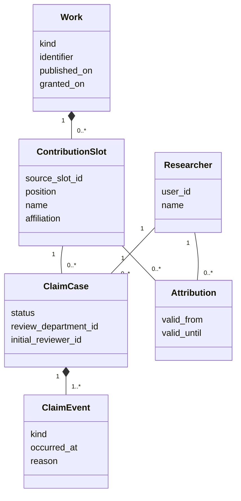
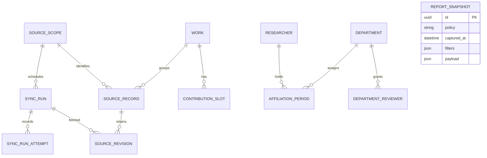

# 领域对象与数据关系

## UML 类图 · 认领相关领域

一个申请对应一个具体署名位，`(slot, researcher)` 唯一；同一署名可有多条已撤销历史归属，`valid_until IS NULL` 的归属至多一条，由 PostgreSQL 条件唯一约束保证。审核事件保存操作者和原因；数据库触发器阻止普通行级更新和删除。归属不通过申请 FK 关联，统计只使用 `Attribution` 的当前有效条目，不从推荐或申请状态推断。

## ER 图 · 来源、作业、组织与快照

`(kind, identifier)` 唯一标识成果；专利公开与授权合并到同一申请。来源版本和当前规范成果是两层数据。`ReportSnapshot` 保存冻结条件与事实 JSON，不以可变业务对象的 FK 代替快照数据。已冻结事实按当前授权重新投影，旧内容不因后续审批而重算。历史任职按 `[starts_on, ends_on)` 判定，不与当前审核管辖或授权混用。
