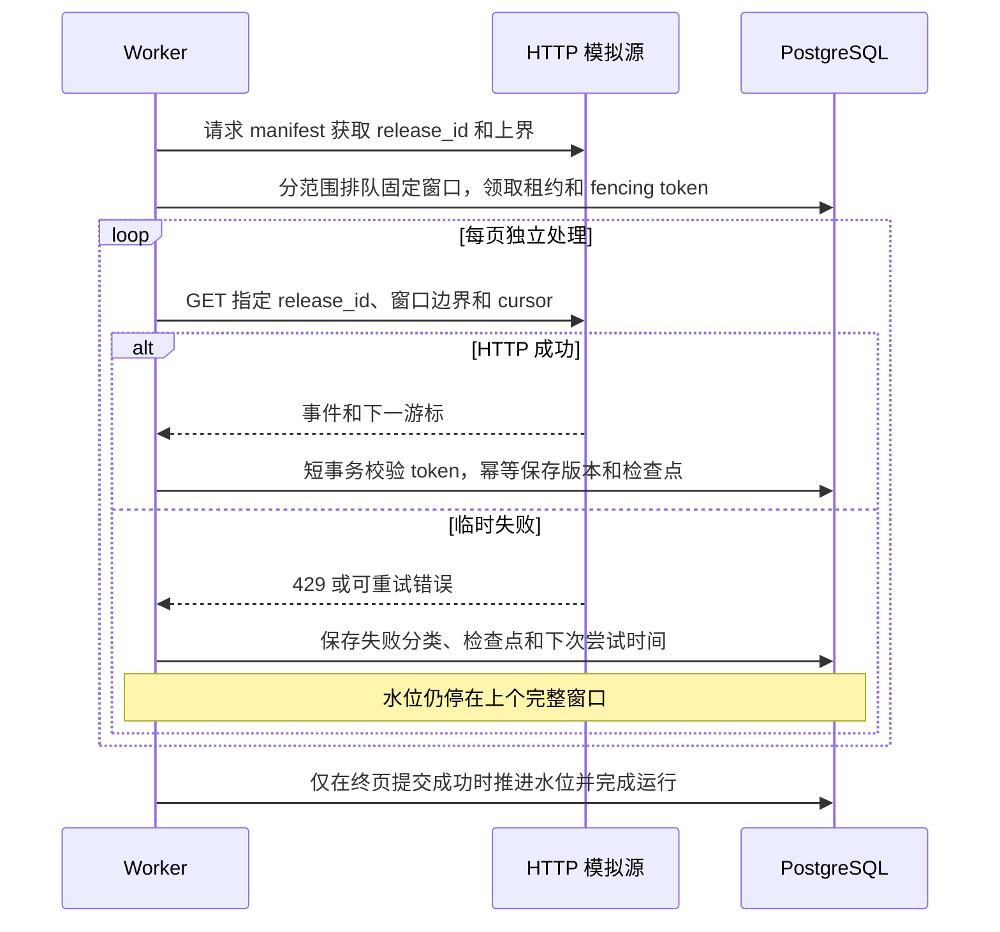
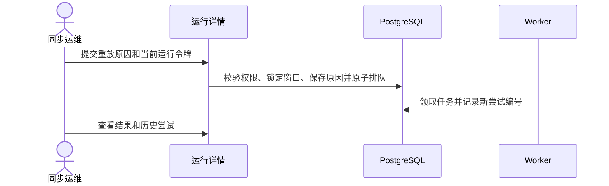

# 同步时序与失败语义

## UML 时序 · 固定发布批次与续跑

读取为至少一次：一个 HTTP 请求在数据库事务外；页面重复处理不能复制成果、署名或版本。游标绑定窗口，时间相同用稳定事件键排序。检查点、租约和水位分开：过期 Worker 不能提交；坏事件可阻断当前数据流，另一流继续。

Operator 通过[演示脚本](../operations/demo.md)推进模拟发布及重放；不手工推进水位。测试验证 HTTP 第 2 页 429、数据库重启恢复、重复版本去重与 fencing，参见 [归集测试](../../tests/test_ingestion.py)。历史窗口重放不直接创建申请和归属。

## 人工重放

等待重试或阻塞的窗口保留已提交检查点，成功窗口从头重放。运行令牌和唯一约束防止重复提交。操作详情展示失败分类，原始响应保留在同步内部。
