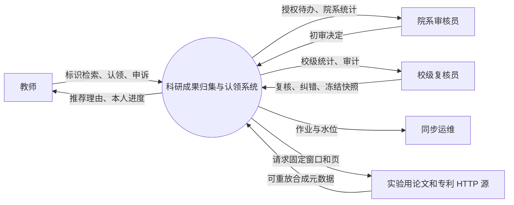
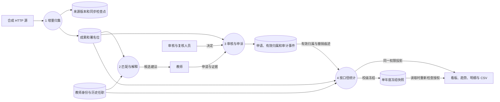
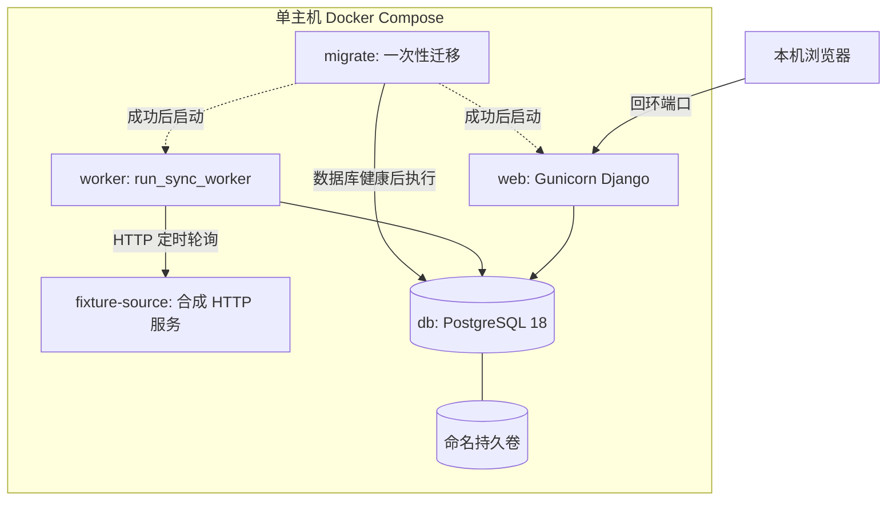

# 运行架构与数据流

基线：单校、多院系，Django 模块化单体；独立合成 HTTP 源；PostgreSQL 是业务数据、作业和会话的权威存储。没有 Redis、外部 LLM 或正式考核数据。

## DFD 0 · 系统上下文

## DFD 1 · 处理与存储

## 容器部署视图

边界：不发布 PostgreSQL 或模拟源的宿主端口；生产式部署需要主机、HTTPS 和运维配置。代码路径分别为 `apps/sources`、`apps/catalog`、`apps/matching`、`apps/claims`、`apps/reports` 和 `apps/people`。图描述的是部署结构和数据流，不是独立微服务。
