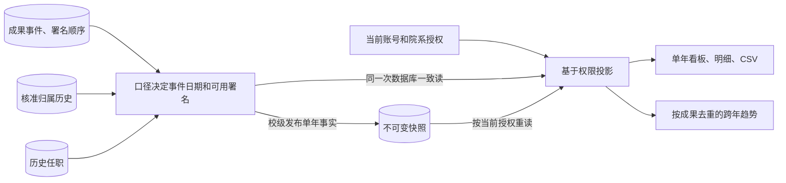
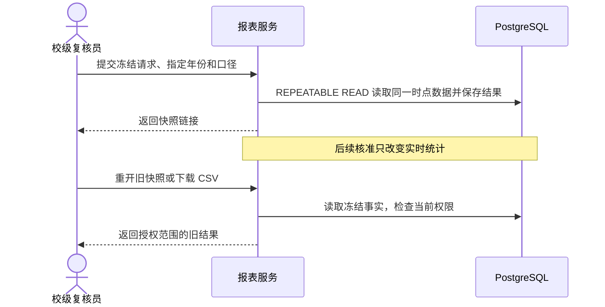

# 统计数据流与一致性

## 统计 DFD · 实时结果与冻结事实

## UML 时序 · 相同年度的两个视图

- **年度按成果事件**，不按导入时间、认领提交日或初审院系；[业务评审](../design/03-业务评审.md)给出两种口径的手算例子。
- 院系分别按成果去重；校级总数按成果独立去重，不是院系数相加。不能确定历史主归属时不归到当前院系。
- 跨年趋势保留同一口径、类型、指定成果与授权范围，缺年填 0；链接到实时单年明细。单年快照不混入实时趋势或实时样例提示。
- [黄金数据用例](../../tests/test_reports.py)核对导出、覆盖/撤权与冻结。 [趋势用例](../../tests/test_acceptance_trend.py)验证年度下钻与缺年。
