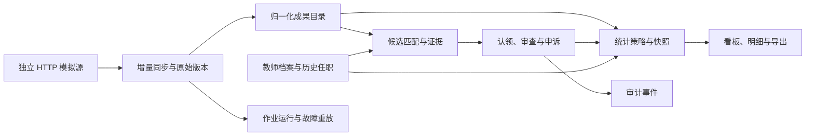
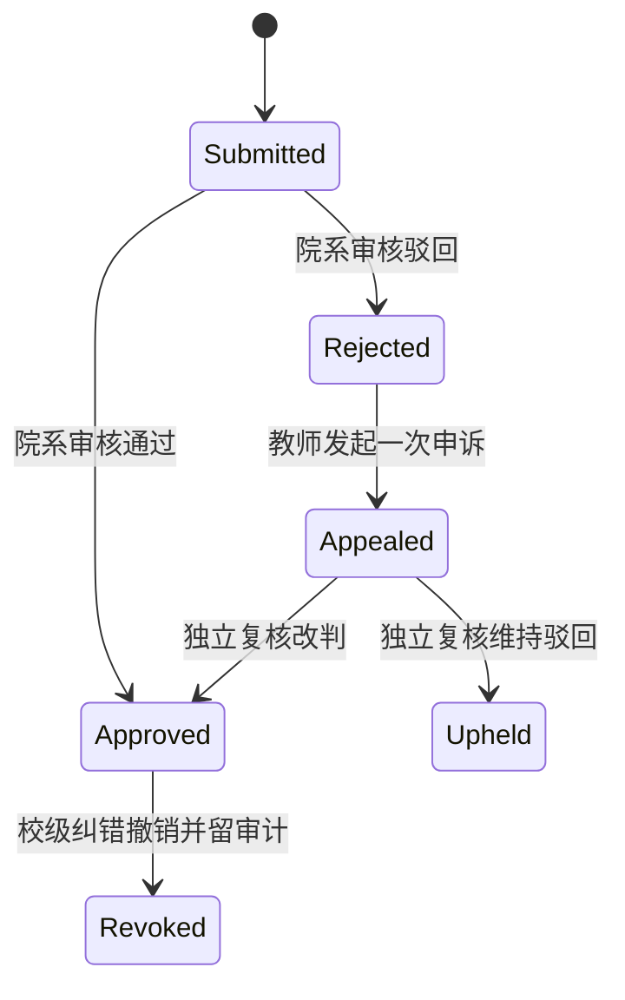

# 系统架构与关键设计 v0.3

状态：已完成技术评审；选型见[技术评审](04-技术评审.md)，业务语义以[业务评审](03-业务评审.md)为准。所列约束不代表已实现。 | 2026-11-24

## 架构决策

**ADR-01 模块化单体。** CPython 3.14、Django 5.2 LTS、PostgreSQL 18；服务端模板和少量本地 JS；同一 Docker 镜像以 Gunicorn Web 和 Django management command Worker 运行。`SyncRun` 在 PostgreSQL 持久化排队、租约和检查点，是同步任务唯一真相；首版不部署 Redis、Celery、Kafka、Kubernetes、独立 SPA 或模型服务。Worker 短事务领取任务，网络 I/O 在事务外，页提交用 fencing token 拒绝过期 Worker。详见[技术评审](04-技术评审.md)。

模块 API 为 Python 领域服务和角色化 Web 端点，少量 JSON 只用于视图；首版不承诺通用开放 API。迁移、合成种子和业务测试单独维护。开发、CI、演示均使用 PostgreSQL，不用 SQLite 模拟并发语义。

## 归集与数据模型

- `SourceScope`、`SyncWindow`、`SyncRun`：记录连接器、过滤范围签名、窗口/分区边界、结果及错误明细。更改机构或过滤范围生成新水位；触发间隔、回看量和滞后可配置。手动补拉不得越过未成功窗口移动主水位。
- `SourceRecord`、`SourceRevision`、`ContributionEvidence`：源内外键、内容哈希和时间/分区，保留足以重放的精选元数据，标记来源、抓取时间及原始版本。随仓演示只使用合成数据；未来外部数据按各源使用权处理。旧事件不能覆盖较新源版本；无法定序的来源更改留待核对。
- `Work`、`WorkIdentifier`、`WorkEvent`、`ContributionSlot`：论文优先用规范化 DOI 去重；专利用同一管辖区与可靠申请号合并 A/B 事件、用文献号和 kind/correction 代码记录源版本。缺少可靠标识只做源内幂等或待复核，禁止按标题强合并。稳定的内部署名 ID 不等于可变的作者位置；源顺序/身份发生有歧义变动时建立冲突，不把原核准移给另一署名。统一用贡献者，论文映射作者，专利映射发明人（申请人是另一实体/角色）。
- `Researcher`、`AffiliationPeriod`：校内人员 ID、别名、可验证标识及带生效区间的院系任职；真实数据接入的组织/身份维护权限单独授权。
- `MatchSuggestion`、`Claim`、`ReviewDecision`、`Appeal`、`Attribution`：候选证据与业务判断相互独立；只有 `Attribution` 的有效期进入统计。`AuditEvent` 记录动作身份、时间、对象、前后状态和理由，业务接口不提供编辑历史的路径；不宣称能防数据库超管篡改。
- `MetricPolicy`、`ReportSnapshot`、`ReportSnapshotRow`：发布后不修改政策定义；快照冻结过滤参数、政策版本、实现版本、取数时间、已计算汇总及授权明细所需事实/排除原因。历史事实不变，展示时仍须执行当前访问权限。

### ADR-02：可重放增量，而不是相信一次抓取

1. Compose 中独立的 `fixture-source` 通过 HTTP 暴露论文与专利两类资源，提供稳定 ID、UTC `updated_at`、游标分页及可控发布批次。由 Worker 的调度触发增量任务，限定半开时间窗 `[from, to)`；每次任务固定上界，允许回看，同一时间戳按稳定键断同值。窗口/源批次在跑批期间不变化。续跑可重扫小窗口，不把分页游标当长期水位；未来连接器实现同一取数契约，不改业务管线。
2. 按页事务写入原始版本和归一化结果；入库同时写持久化重算任务，供匹配独立重试。原始数据和业务表写入不持有跨外部请求的 DB 事务。至少一次处理，以 `(source, external_id, content_hash)`、规范标识唯一约束与版本比较抵消重放副作用。
3. `429`/临时异常按厂商 `Retry-After` 或有上限的指数退避重试；鉴权、契约错误单列。不可解析记录隔离；在修复或显式批准例外前窗口不标成功，例外记录计数、原因及重放入口。按范围避免同窗双跑；任务用租约、递增令牌和事务校验拒绝过期 Worker 写入/推进水位。
4. 全窗确认成功才推进该范围水位。运行页分别展示已归集时间、匹配积压、来源与失败；纠错/删除先解释并待复核，不能把一次暂未返回当删除，也不能清空人工认领。演示同步标识为 `fixture`。模拟源提供固定发布序列、可配置页大小和限流/失败场景，测试故障控制仅在模拟服务启用，不放入业务接口。

### 模拟源契约与验收样例

- `GET /v1/manifest` 返回当前发布批次和各流已发布的时间上界；同一任务固定 `release_id` 与上界。固定种子使同一版本的批次、记录和真值可复现。
- `GET /v1/{works|patents}` 接受 `release_id`、`from`、`to`、`cursor`、`limit`，返回按 `(updated_at, event_id)` 升序的变更事件与 `next_cursor`。事件包含源记录标识及该版本内容；`event_id` 稳定、用于同时间点定序，原始版本是否重复由业务幂等键判定。出版时间、授权时间不参与拉取水位。
- 第一批：一篇论文、一件公开专利；第二批：一篇新增论文、一篇旧论文的机构元数据修订、旧专利对应的授权文献、一条重复版本。第二批完成后应是两篇论文和一件专利；修订与授权可追溯，重复事件不增加成果/署名/归属。
- 调小分页并在第二批中途注入 HTTP 失败：允许此前页面入库，失败时对应数据流水位不得前移。清除故障后重新跑窗，业务终态须与无故障一次成功相同。再跑同窗应保留作业记录，但不得产生重复业务副作用。另有独立用例从定时调度开始验证自动拉取。

## 消歧与评测

**ADR-03：可解释排序，机器可弃权，不自动核准。** 将单个署名/发明人提及链接至本校教师库，允许“无校内匹配”。先以标准化姓名、别名、拼音或可信 ID 召回候选；再取身份标识、成果日期处的机构历史、已存在的合作关系、主题或标题信号做加权排序，缺失与冲突分别处理。合作特征只使用评测时点之前可得的历史。适配专利角色，不能复用论文的作者字段当专利发明人证据。经验证标识冲突、分数过低、候选差距小均可禁止高置信推荐；分值不是经校准的概率。无推荐时教师仍可通过标识检索并申请。

- 姓名基线与多特征方案走同一数据协议、相同候选范围，记录分数/差距阈值和代码版本，验证集选阈值、测试只跑最终口径。以姓名歧义块隔离验证/测试，另约束成果 ID/近重复不跨集；对测试目标的历史画像只用事前可得信息，不把本人同条成果或评测标签回填成输入。
- 合成生成器先分配隐藏的真实人员关系和 `无校内匹配`，再独立生成噪声、缺失项和冲突，标签与供系统读取的公开记录分开；暴露的 ID、标题和备注不得编码真值。同一个 ORCID 不同时作为特征与唯一真值。可信标识缺失、中文同名、调动、多署名及无校内匹配单独成组；另用手工编写的独立挑战集检验对生成规则的依赖。所有结论限定于模拟任务。
- 命中对以提及—校内人员为单位；预测错人产生 FP 并导致真关系 FN，弃权对正样本为 FN。报告 Precision/Recall/F1、候选 Recall@K 与 Top-1 命中、建议覆盖率、冲突/弃权数和小样本不确定性；用阈值曲线说明误认和遗漏的折中。通用论文聚类基准只能作为方法参照，不能直接给本校链接/专利结论。

## 认领、审核与历史

候选上的「不属于我」只抑制该推荐，并不产生认领；推荐因新证据重算也不能覆盖历史审核。每次状态变更在一个事务内做权限、状态、并发校验和审计；同一人同署名不能重复发起在办认领，同一署名只允许一条当前有效归属。跨人竞争可并列待审，批准一条后其他记录进入有理由的冲突处理；复核不能静默覆盖他人归属，必须执行明确的纠错动作后才可改判。施加对象级权限于列表、详情、状态变更、统计下钻和导出，不能仅隐藏按钮。

## 统计与演示设计

**ADR-04：版本化策略 + 可复现快照。** 策略可切换日期依据、作者顺序、专利事件与聚合单位，以声明式字段和受控策略实现，不让管理员写 SQL。页面顶部显示口径、覆盖源、快照/实时、更新时间；折线、院系条形图、待处理队列卡片是入口，而不是黑箱数字。支持从计数下钻到为何计入/排除，并可从成果详情追溯来源和有效认领。汇总、钻取、CSV 共享同一业务查询；实时查询标明可能变化，需要一致引用使用冻结快照。

答辩剧本：从模拟 HTTP 源自动归集 → 发布第二批并验证新增、更新及重复不增 → 区分同名者并查看证据 → 教师认领、审核驳回、申诉改判 → 两人合著通过 → 切换口径查明差值 → 重开旧快照显示历史不变。两套口径可用一个固定案例验算：2025 年论文第一作者属甲院、第二作者属乙院，均已通过，概览中甲乙各 1、校级 1；严格口径只甲院计 1。若另有一件 2025 年公开、2026 年授权且首位发明人属甲院的同辖区专利，概览在 2025 年计一次，考核示例在 2026 年计一次。

## 开源、持续交付和运行安全

- 开源仓库建议先本地起草；确认归属、许可证和发布范围后再公开。计划使用独立 `CI`/`Release`/`Deploy`，main 受检查保护；锁定依赖，第三方 Actions 固定到提交。公开仓库只放合成数据及可再分发的最小样本和许可说明；真实名册、证据、原始源数据、课件、课程凭据、带登录信息的日志不得入库或打包。
- PR 门禁：静态检查、迁移检查、单元/连接器契约、PostgreSQL 事务/并发测试、离线评测回归、角色化浏览器 E2E、镜像/Compose 冒烟。不要求第三方 API 验活，测试通过 Compose 内部 HTTP 完成。依赖/秘密扫描建议作为仓库门禁，评测报告和测试产物可追溯。
- 发布：版本标签触发构建一次，产出镜像、SBOM/摘要、变更日志和 Compose 演示附件，向 GHCR 发布不可变引用。部署：同一 digest 部署到演示环境，迁移前备份、健康检查和冒烟；失败回滚到上个兼容版本，不默认数据库迁移可反转。尚无演示主机，不许把“可部署/可持续交付”写成“线上已持续部署”。
- 默认演示绑定本地、只用合成账户；公开实例如有，应隔离演示数据，不沿用默认凭据。Web 正式环境使用 HTTPS、非调试设置、会话和 CSRF 保护，数据库不直曝；任何导出按用户权限并防 CSV 公式注入。用结构化日志和健康端点跟踪同步延迟、任务积压及处理异常，日志不含证据正文与凭据。运行手册覆盖备份恢复、错误重放、版回退。
