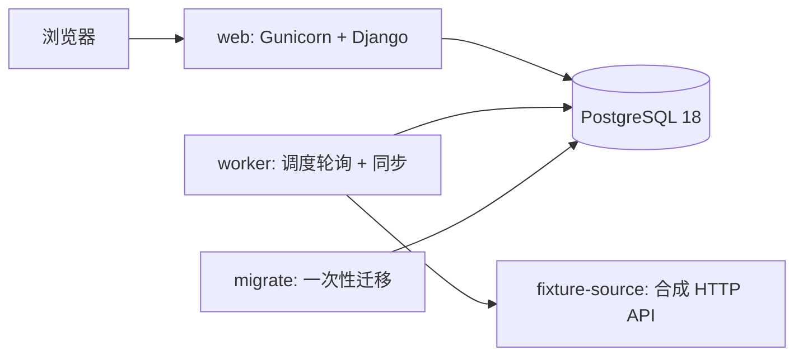

# 技术方案评审 v0.1

评审日期：2026-11-24。建议采用 Python/Django 模块化单体、PostgreSQL 单一持久化服务及数据库任务表、Docker Compose 部署。首版**不引入 Redis、Celery、Kubernetes 或微服务**。这是按当前负载做的有意识简化，不是认为这些技术不适用。尚未实现或验收。

## 1. 选型结论

| 层次 | 选择 | 边界 |
|---|---|---|
| 运行时 | CPython 3.14.x | Web、Worker、消歧和评测统一运行时 |
| 后端 | Django 5.2 LTS、ORM、Session/CSRF、服务端模板 | 按领域拆 apps，不建独立 API 或管理 SPA |
| 数据库 | PostgreSQL 18.x + Psycopg 3 | 业务、任务、审核和快照唯一真相；SQLite 不用于集成/并发验收 |
| 后台任务 | `SyncRun` PostgreSQL 持久队列 + 独立 Django management command | 不运行 Redis、Celery Beat 或通用消息平台 |
| Web | Gunicorn + Django WSGI | Web、Worker 共用镜像而运行不同命令 |
| UI | Django Templates、CSS、原生 HTML 图表 | 首批实现不需要 Node 或外部 CDN；界面复杂化后再评估图表构建工具 |
| 依赖 | `pyproject.toml` + `uv.lock` | 锁文件入库，更新走 PR |
| 测试 | pytest、pytest-django、Playwright pytest、Ruff；纯领域模块类型检查 | 单元、PG 集成、模拟源契约、浏览器 E2E、离线评测分层 |
| 容器/发布 | Dockerfile、Docker Compose、GitHub Actions、GHCR | PR 门禁；标签构建镜像和演示包；无主机前不宣称自动部署 |

Python 3.14 的 bugfix 阶段计划至 2027 年 10 月，之后进入安全维护，生命周期至 2030 年 10 月；Django 5.2 是 LTS，至少三年安全更新，且 5.2.8 起支持 Python 3.14。PostgreSQL 选 18 作为首版基线，不追逐新主版本。实施时固定补丁版本与基础镜像摘要，不用浮动 `latest`。

## 2. 为什么选 Python/Django，而不是 Go

| 维度 | Python + Django | Go Web 栈 |
|---|---|---|
| 主要工作 | Django 集成 ORM、迁移、会话、CSRF、表单和模板，适合审核/申诉及报告工作台 | 并发 I/O 和单二进制有优势，但登录、表单、院系权限与工作台要自行组装 |
| 消歧评估 | 候选、特征、离线试验同语言，无跨进程序列化 | 做高吞吐采集器适合；匹配评估需另建实现或再引入 Python |
| 性能与发布 | 单机课程负载足够，Docker 解决目标机 Python 环境 | 执行效率和二进制体积占优，但当前未发现该瓶颈 |
| 维护成本 | 一套运行时、领域模型和测试 | Go 采集器 + Python 管理台会增加契约、镜像、依赖、测试与发布链 |

首版单一用 Python。不是说 Go 不能做好，而是核心在协作流程和数据判定，不在高吞吐代理。只有负载测试确认独立模块在数据库/算法/批次优化后仍受 CPU 或网络限制，才为该边界做 Go 原型；不预先混合语言。FastAPI 面向 API 服务合适，但后台工作台要额外组装能力。

## 3. 数据库与队列：PG 单独够不够

### 决策：首版 PostgreSQL 单库，不配 Redis

当前只有定时源同步、教师触发的短任务和小规模合成数据；无通知队列、实时推送、缓存或高 fan-out 作业。`SyncRun` 同时是持久运行账本和待执行任务：Web 提交，Worker 领取、续租、完成并记错，任务和业务事实共用事务。

PostgreSQL 文档将 `SELECT ... FOR UPDATE SKIP LOCKED` 列为适用于队列表的场景。只用其竞争领取，不替代报表一致性读取。Django 提供 `select_for_update(skip_locked=True)`；并发必须在 PostgreSQL 测试，SQLite 不支持该语义。

### 任务领取与恢复

1. 调度循环查到期 `SyncScope`，按 `(scope, window_start, window_end)` 唯一键创建 `SyncRun`；重复调度不重复建运行。
2. Worker 在短事务内锁定最早可执行/租约过期记录，写 `RUNNING`、`lease_until`、递增 `fencing_token` 和尝试数后提交。**不得在 HTTP 请求或整次同步期间持有数据库锁/事务。**
3. HTTP 请求在事务外；每页返回后短事务校验 token，幂等写来源版本、归一化事实和 cursor。过期 Worker 不能提交或推进水位。
4. 已提交页可保留；全窗成功且没有未处置坏记录后才推进水位。失败保留检查点、分类、退避和重放入口；同页重放终态与一次成功相同。
5. 重启仅从数据库恢复；状态/下次尝试/范围索引、唯一约束、退避轮询与租约心跳支持多个 Worker。

| 方案 | 收益 | 代价/风险 | 结论 |
|---|---|---|---|
| PG `SyncRun` 队列 | 单一持久真相；任务、水位、检查点能事务更新；Docker 少一服务 | 需严谨实现租约、fencing、重试并做并发测试；不适合海量短任务 | **P0 采用**，仅实现同步专用窄队列 |
| PG + Redis/Celery | 多队列、路由和重试工具成熟，便于扩容 | 多一服务、故障面及持久化运维；仍可能重复/丢消息，离不开 PG 账本和幂等 | 暂不采用，任务族或负载发展后重评 |
| Redis 缓存 | 热点读取可降延迟 | 目前无热点；增加失效策略、一致性和部署组件 | 不采用，先优化 SQL/索引 |

Celery Redis 文档说明 transport 模拟确认；默认 RDB 重启可能丢上次快照后的任务，AOF `appendfsync everysec` 也留下约一秒窗口。将来启用时仍以 PG `SyncRun` 为真相，消息只传运行 ID，通过幂等和待处理扫描恢复，不依赖 result backend 证明业务完成。

**升级触发**：目标数据量压测显示队列等待持续超过采集间隔、队列表锁/轮询明显影响业务，或出现需要多队列路由的通知/报表/重算任务，再评审 Celery + Redis；不因“常见”而加入。
## 4. Docker 部署拓扑



同一应用镜像用不同命令启动。`compose.yaml` 包含 `db`、`fixture-source`、一次性 `migrate`、`web`、`worker`；不含 Redis、Celery Beat 或 Kubernetes。生产单机可增加反向代理和 TLS 配置，等主机/域名确定后再写。

- `db` 使用 PostgreSQL 18 支持的最新补丁镜像和命名卷；不向公网发布数据库端口。演示卷在 `docker compose down` 后保留；清卷是显式破坏性操作。需提供 `pg_dump` 备份/恢复演练，卷不是备份。
- `fixture-source` 提供固定版合成数据、可控分页和失败；其健康检查通过后才启动 Worker。
- `migrate` 在数据库健康后运行，成功结束才启动 Web/Worker，避免多实例并发迁移。发布先备份、迁移、冒烟；危险变更分步上线，不承诺所有迁移可逆。
- 应用容器非 root，配置重启、健康检查和优雅停机。Python 依赖及静态资源在镜像构建阶段准备；运行容器不带 Node/npm。生产不把源代码目录 bind-mount 进容器。
- 演示默认仅向本机回环地址映射 Web 端口；数据库只在 Compose 内网访问。生产凭据由主机秘密管理/注入，不进镜像、Git 或答辩 ZIP。演示账户只用于本地合成数据。
- 部署包验收包括 Compose 配置检查、空卷启动、健康检查、合成数据导入、浏览器主路径、数据库重启和备份恢复。无公网主机前交付可运行 Compose 包，不声称线上托管。

计划的统一命令包括 `docker compose up --build -d`、`docker compose ps`、`docker compose logs -f worker`；待实现后再固化用户手册，不提前声称已运行通过。

## 5. 应用边界与关键数据约束

```text
config/        Django settings、URL 和 WSGI 入口
apps/people/   Researcher、账号映射、历史主归属
apps/sources/  SourceScope、SyncRun、SourceRecordRevision、模拟连接器
apps/catalog/  Work、WorkIdentifier、WorkEvent、ContributionSlot
apps/matching/ 候选召回、特征/解释、版本化排序、离线评估命令
apps/claims/   ClaimCase、Appeal、决策/纠错事件、Attribution
apps/reports/  版本口径、快照及解释行
apps/audit/    业务审计事件
templates/     服务端页面
static-src/    CSS/JS/图表和图标源码
```

领域写入经各模块 service/use-case；不直接改其他模块表，也不造通用 Repository、CQRS 或 Event Bus。先用清晰调用与事务，只有出现实测隔离需求才拆服务。

| 对象 | 不变量与存储原则 |
|---|---|
| `WorkIdentifier` | `(scheme, jurisdiction, normalized_value)` 唯一；DOI 规范化后匹配，标题不能强合并。专利公开/授权文献关联同一申请，不重复创建成果 |
| `ContributionSlot` | 表示成果中的具体作者/发明人位置；来源修订保存版本化位置和证据。来源无稳定映射且署名顺序变化时标冲突，不静默移交既有认领 |
| `SyncRun` | `(scope, window_start, window_end)` 唯一定位窗口；含状态、cursor/checkpoint、attempt、lease、fencing token、失败码和水位；至少一次处理、业务写入幂等 |
| `ClaimCase` / `ClaimEvent` | 申请关联一个署名位置；事件只追加，状态与事件在同一原子转移更新；申请/审核/复核身份由集中 policy 校验 |
| `Attribution` | 表示已确认归属，不等于推荐或申请。PostgreSQL 条件唯一索引保证同一署名至多一条 `valid_until IS NULL` 的有效归属；应用锁不能替代数据库约束 |
| `AffiliationPeriod` | 显式生效日期与主归属；主归属重叠为待核冲突，不按当前院系猜历史；并发区间写入纳入测试 |
| `ReportSnapshot` / `SnapshotRow` | 保存政策/代码版本、过滤条件、生成时间、计数事实及纳入/排除理由。单一短事务用 `REPEATABLE READ` 查询和写入不可变结果；后续认领或规则修改不回写旧快照 |

权限以 Django 账号/组作为身份基础，业务对象权限由集中 policy service 与过滤后的 QuerySet 共同执行。列表、详情、状态变更、下钻、CSV 都授权，不能只隐藏按钮或依赖 Django Admin。普通业务管理员不设 `is_superuser`；超级用户是受限紧急运维身份，能绕过应用权限，需保护凭据并审计使用。不得声称数据库/主机管理员无法访问数据。
## 6. 消歧算法与评估实现

算法先于模型服务：Python 纯领域模块，不调 LLM，也不自动确认归属。

1. 候选召回：规范化姓名/别名（含数据中明确维护的拼音别名）和可信标识；保留“无校内匹配”，也允许教师通过成果标识主动认领。
2. 可解释特征：可信 ID 一致/冲突、姓名别名、事件日院系、历史合作、题名关键词/学科线索及字段缺失。证据冲突单独标注，不能被普通负分抵消。
3. 版本化排序：初版用透明加权分和硬规则，保存候选、特征证据、分数、算法版本与时间。验证集设阈值及候选差；低分、窄差、身份冲突则弃权。建议只给教师本人看，不创建有效归属。
4. 比较姓名基线和多特征版，输出样本量、分层 Precision/Recall/F1、Top-1、Recall@K、建议覆盖率、弃权率及错误案例。按研究者和歧义姓名组切分，避免身份模板泄漏；用人工挑战集覆盖同名、调院、缺机构、别名、非校内作者。结果只代表合成任务。

评估脚本首版用标准库。若以后比较学习型分类器，可在离线实验单独引入 scikit-learn 并锁定模型/特征版本；除非验证有益，否则模型依赖不进 Web 镜像。

## 7. 测试矩阵与 CI/CD

| 层次 | 必须验证 | 运行位置 |
|---|---|---|
| 单元 | 标识规范化、评分/弃权、政策计数、状态转移、权限 policy | pytest，无网络 |
| PG 集成 | 条件唯一索引、并发认领/审核、隔离级别、租约/fencing、历史任职冲突 | Compose PostgreSQL 18；锁测试用事务测试，禁止 SQLite 假通过 |
| 模拟源契约 | 游标边界、同时间排序、两批新增/更新/重复/授权、失败页恢复、水位不前移、同窗重放 | fixture HTTP + worker + PG |
| 浏览器 E2E | 主动认领、驳回/独立复核、越权拒绝、口径切换、旧快照、CSV/UI 对账 | Playwright + Compose |
| 评估回归 | 冻结合成清单和错误案例 | 离线 Python 命令，报告样本量，不外推真实准确率 |
| 部署冒烟 | 空卷构建启动、迁移、健康检查、演示与备份恢复步骤 | Docker Compose/Actions |

PR CI 执行 `uv sync --locked`、Ruff、领域模块类型检查、Django system check、迁移漂移检查、pytest、PostgreSQL 集成、关键 Playwright 流程和 Compose 冒烟。测试只依赖本地 fixture。`main` 要求检查通过；Actions 使用最小 Token 权限，第三方 action 固定完整 commit SHA；依赖、基镜像和 Actions 通过更新 PR 管理。

Release 按 Git tag 对单一源码构建不可变镜像并推送 GHCR，附 SBOM/构建来源、版本化 Compose 演示包和变更记录。演示用固定版本/摘要，不从 `main` 临时构建。选定主机后再以受保护 GitHub Environment 部署；凭据经 OIDC 或主机注入，不进入 PR CI。

## 8. 风险与退出条件

- 数据库队列仅实现 `SyncRun`。必须证明并发 Worker 不重复推进水位、崩溃后租约恢复、过期 Worker 被 fencing、数据库重启后可重放；任一项不稳定就重评 Celery/Redis。
- 开发、CI、演示统一 PostgreSQL 18；SQLite 不满足行锁验收。
- Compose 适合演示和单机运行，不提供多机 HA、自动扩缩或托管备份。公网部署还需 TLS、主机加固、外部备份/恢复演练、日志轮转和监控。
- 当前公开仓库尚未选许可证。核对代码、依赖和演示数据许可前，不称其为有许可证的开源发布。
- 本轮不装依赖、不建数据库、不写运行代码、不加空 CI、不配置未知主机部署，也不声称容器验收通过。

## 9. 技术决议

1. Python/Django 5.2 LTS + PostgreSQL 18 模块化单体；Python 3.14、PG 18 用最新补丁，依赖锁定。
2. 首版任务状态及调度由 PG `SyncRun` 持久队列承担；不部署 Redis/Celery，保留以负载证据升级的边界。
3. Docker Compose 是开发、CI、课程演示标准入口；Web/Worker 共用镜像，PG 用命名卷，fixture 提供可复现 HTTP 数据。
4. 并发、唯一约束和快照在 PostgreSQL 18 测试；须有实现与测试日志后才能标记完成。
